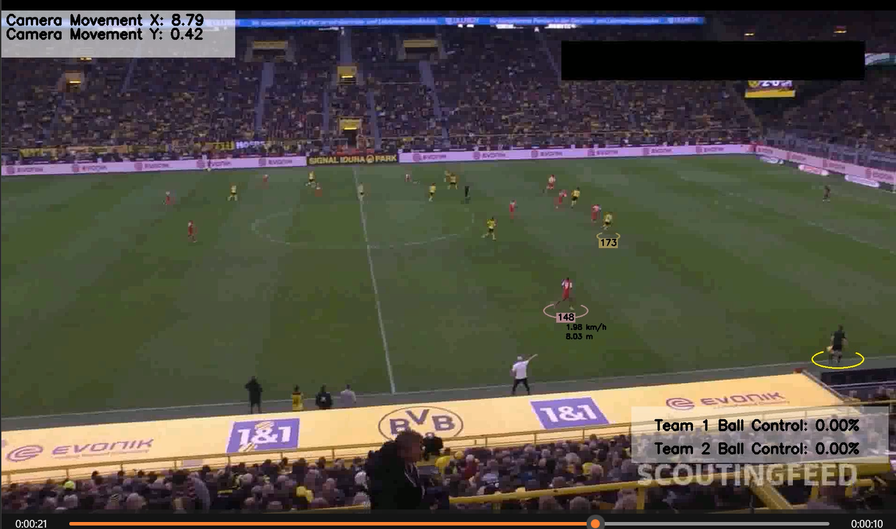

# Football Analysis Project

## Introduction
The goal of this project is to detect and track players, referees, and footballs in a video using YOLO, one of the best AI object detection models available. We will also train the model to improve its performance. Additionally, we will assign players to teams based on the colors of their t-shirts using Kmeans for pixel segmentation and clustering. With this information, we can measure a team's ball acquisition percentage in a match. We will also use optical flow to measure camera movement between frames, enabling us to accurately measure a player's movement. Furthermore, we will implement perspective transformation to represent the scene's depth and perspective, allowing us to measure a player's movement in meters rather than pixels. Finally, we will calculate a player's speed and the distance covered. This project covers various concepts and addresses real-world problems, making it suitable for both beginners and experienced machine learning engineers.

## Modules Used
The following modules are used in this project:
- YOLO: AI object detection model
- Kmeans: Pixel segmentation and clustering to detect t-shirt color
- Optical Flow: Measure camera movement
- Perspective Transformation: Represent scene depth and perspective
- Speed and distance calculation per player

## Trained Models
- [Trained Yolo v5](https://drive.google.com/file/d/1DC2kCygbBWUKheQ_9cFziCsYVSRw6axK/view?usp=sharing)

## Requirements
To run this project, you need:
- Python 3.10+
- A Python environment with the dependencies from `pyproject.toml`

## Setup (uv)
1. Install uv (see https://github.com/astral-sh/uv)
2. Create the environment and install dependencies:
   - `uv sync`
3. Copy environment config:
   - `copy .env.example .env`
4. Run:
   - `uv run python main.py`

## Realtime (prototype)
- Mục tiêu: chạy gần realtime từ một nguồn video (webcam / file / RTSP / HLS URL nếu OpenCV đọc được) và xem kết quả trong trình duyệt.
- Lưu ý: nếu nguồn “web đang chiếu” là DRM (Widevine/PlayReady) thì không lấy trực tiếp URL stream được; khi đó cần giải pháp capture màn hình.
- Lưu ý model: cần weights hợp lệ cho Ultralytics YOLO. Nếu `models/best.pt` không load được, hãy thử đặt `DFB_MODEL_PATH=yolov8x.pt` hoặc trỏ tới weights của bạn.
- Ghi chú repo: các file `.pt` trong repo hiện là Git LFS pointer, nên cần tải weights thật (git lfs pull) hoặc bật `DFB_USE_STUBS=1` để chạy demo bằng stub cho video mẫu.

1. Cấu hình nguồn realtime trong `.env`:
   - `DFB_REALTIME_SOURCE=0` (webcam) hoặc `DFB_REALTIME_SOURCE=rtsp://...` hoặc `DFB_REALTIME_SOURCE=https://...m3u8`
2. Chạy server:
   - `uv run python realtime_server.py`
3. Mở trình duyệt:
   - `http://127.0.0.1:8000/`
